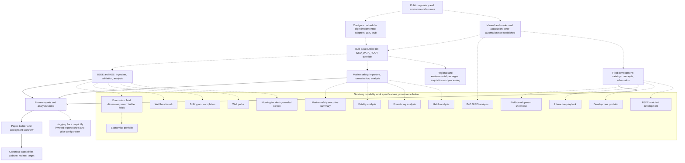

# Repository architecture and report inventory

This is a source inspection of the committed repository, not a live-data or deployment audit.
Scope: [issue 1083](https://github.com/vamseeachanta/worldenergydata/issues/1083).
Inspection baseline: `7f645ac5844b25a79374f62fb0230ef1dbb4b143` on 2026-10-12.
It extends the module-level drawings in [BSEE architecture](bsee/bsee_architecture.puml)
and [BSEE refresh flow](bsee/data-refresh-architecture/data-flow-diagram.md).
Paths below are relative to the repository root; colon suffixes are source line numbers.

The tree contains **272 report HTML files and zero API capability HTML pages**.
The former API capability directory was intentionally removed by
[PR 1141](https://github.com/vamseeachanta/worldenergydata/pull/1141).
The surviving builder defines **21 work specifications**, including **seven economics fields**,
plus five section summaries. These are not 21 surviving API pages.
The issue's earlier report counts are therefore not the inventory baseline.

## Drawing

Solid arrows show implemented processing or publication relationships. Dashed arrows show
documented inputs, grouped provenance or configured refresh intent; they do not establish
a running scheduler, current upstream data, or a successful deployment.
Capability nodes represent the surviving builder specifications, not live API endpoints.

Figure 1. Repository data paths and capability provenance. Not every source feeds every
capability; the unconnected regional node has no implied edge to a curated report.

## Ingestion and processing evidence

The registry at `data/catalog/source-registry.yml:1-6` supplies source metadata, not a scheduler.
For example, BSEE and SODIR registry frequencies differ from the configured job intervals.
The scheduler configuration defines nine enabled jobs, but the LNG adapter returns a skipped
result. Thus eight adapters implement acquisition; operational execution is not established.
The scheduled workflow in `.github/workflows/nightly.yml:3-40` runs tests, not ingestion.

| Source or source family | Refresh established by repository evidence | Processing and evidence |
| --- | --- | --- |
| BSEE filings | Weekly configured; `config/scheduler/scheduler_config.yml:7-11` | `packages/worldenergydata-scheduler/src/worldenergydata/scheduler/jobs/bsee_refresh.py:30-39`; `packages/worldenergydata-bsee/src/worldenergydata/bsee/bsee.py:1-29` routes data to analysis |
| BSEE HSE incidents and INC | Weekly configured; `config/scheduler/scheduler_config.yml:14-20` | `packages/worldenergydata-scheduler/src/worldenergydata/scheduler/jobs/hse_refresh.py:40` uses the BSEE acquirer; does not establish OSHA/EPA refresh |
| SODIR | Daily configured; `config/scheduler/scheduler_config.yml:22-26` | `packages/worldenergydata-sodir/src/worldenergydata/sodir/data.py:1-9`: API, processing, validation, storage |
| EIA | Monthly configured; `config/scheduler/scheduler_config.yml:28-34` | `packages/worldenergydata-scheduler/src/worldenergydata/scheduler/jobs/eia_us_refresh.py:15` uses EIA ingestion |
| Open-Meteo | Daily configured; `config/scheduler/scheduler_config.yml:36-43` | `packages/worldenergydata-scheduler/src/worldenergydata/scheduler/jobs/metocean_refresh.py:15`; does not cover every metocean registry source |
| Brazil ANP | Monthly configured; `config/scheduler/scheduler_config.yml:45-50` | `packages/worldenergydata-scheduler/src/worldenergydata/scheduler/jobs/brazil_anp_refresh.py:9-10`: client and production loader |
| UKCS / NSTA | Monthly configured; `config/scheduler/scheduler_config.yml:52-57` | `packages/worldenergydata-scheduler/src/worldenergydata/scheduler/jobs/ukcs_refresh.py:14-15`: client and production loader |
| Spain CORES | Monthly configured; `config/scheduler/scheduler_config.yml:65-75` | `packages/worldenergydata-scheduler/src/worldenergydata/scheduler/jobs/spain_cores_refresh.py:38`: production loader |
| LNG: FERC, GIE, GIIGNL | Weekly configured, actual refresh not established: adapter is a stub | `packages/worldenergydata-scheduler/src/worldenergydata/scheduler/jobs/lng_terminals_refresh.py:22-52`; sources at `data/catalog/source-registry.yml:196-207` |
| Texas RRC | Explicit on-demand CLI pull; no configured scheduler job | `docs/data-sources/onshore/texas-rrc/raw-refresh.md:13-48`; `packages/worldenergydata-texas_rrc/src/worldenergydata/texas_rrc/processors/__init__.py:11-13` exports permit, production and well processors |
| IMO GISIS | Manual acquisition guidance and an explicitly invoked browser downloader; scheduled refresh not established | `docs/data-sources/MANUAL_DOWNLOAD_GUIDE.md:118-160`; `scripts/download_imo_gisis_data.py:1-8`; analysis builder `reports/imo_gisis_analysis_report.py:1-28` |
| USCG MISLE, NTSB, DLP | Manual download/export guidance; no configured scheduler job | `docs/data-sources/AVAILABLE_DATA_SOURCES.md:45-96` and `docs/data-sources/AVAILABLE_DATA_SOURCES.md:187`; marine importers at `packages/worldenergydata-marine_safety/src/worldenergydata/marine_safety/importers/__init__.py:7-9` |
| TSB, MAIB, EMSA / EMCIP, BTS, Datalastic, SIPRI and DOC Marine Data Portal | Automation not established by scheduler; catalog listing is not an implemented ingest claim | `docs/data-sources/AVAILABLE_DATA_SOURCES.md:110-156`; `docs/data-sources/DATA_ACQUISITION_GUIDE.md:100-121`; capability provenance below |
| DOE, PHMSA, BLS, state maritime reporting, ILO, Paris MOU and Tokyo MOU | Research-catalog candidates; automatic or manual repository ingestion not established | `docs/data-sources/INDUSTRIAL_MARITIME_DATA_SOURCES.md:140-412`; no corresponding scheduler job |
| DNV, Lloyd's Register Foundation, ABS, Bureau Veritas, P&I clubs, INTERCARGO and INTERTANKO | Research-catalog entries, including restricted or discontinued sources; refresh not established | `docs/data-sources/INDUSTRIAL_MARITIME_DATA_SOURCES.md:413-598`; listing is not an access-rights or active-feed claim |
| IMCA, NBIC, MCAD, G+, DAN, dangerous-goods, port/terminal, construction/salvage and LNG-carrier safety | Research-catalog candidates; automatic or manual repository ingestion not established | `docs/data-sources/INDUSTRIAL_MARITIME_DATA_SOURCES.md:599-901` |
| WHOI, MIT Sea Grant and other academic databases | Research-catalog candidates; automatic or manual repository ingestion not established | `docs/data-sources/INDUSTRIAL_MARITIME_DATA_SOURCES.md:902-970` |
| Kansas KGS | On-demand pipeline; automatic cadence not established | `docs/data-sources/onshore/state-well-databases/kansas-kgs-ingest.md`; `src/worldenergydata/modules/state_regulators/kansas_kgs/pipeline.py:1-6` defines raw, normalized and curated stages |
| Oklahoma, New Mexico, Colorado, Louisiana, Wyoming, North Dakota, Utah, Montana, Pennsylvania | Source catalog and access guidance; repository refresh automation not established | `docs/data-sources/onshore/state-well-databases/source-catalog.md:41-364`; no matching job in `config/scheduler/scheduler_config.yml` |
| Terrain: USGS, GEBCO, NOAA NCEI, BOEM | Fetch-on-demand; catalog does not imply all data have been fetched | `data/catalog/source-registry.yml:227-249`; `docs/data-sources/terrain/bathymetry-fetch.md:26-36`; `src/worldenergydata/field_development/bathymetry.py` |
| BOEM reserves; OSHA/EPA; NDBC, CO-OPS, ERDDAP, CMEMS, MET Norway, HYCOM; Canada AER, BCER and Petrinex; Mexico CNH | Metadata frequencies only; automatic refresh not established | `data/catalog/source-registry.yml:49-167`; nine-job configuration is not evidence for these other sources |
| Cost / FRED and public statements | FRED fetch helper plus hand-curated cost observations; scheduled execution not established | `data/catalog/source-registry.yml:9-19`; `scripts/cost/seed_cost_timeseries.py` |
| Wind, oil prices, pipeline safety, vessel hull models, LNGC, BLM | Registry entries; automation not established | `data/catalog/source-registry.yml:181-225`; empty dataset mappings are not ingestion coverage |
| Equipment references | Documentation only; automatic or manual ingest not established | `docs/data-sources/README.md` equipment section; no matching scheduler job |

Table 1. Source families, acquisition status and package-level processing evidence.

The namespace spans the root source tree and domain distributions. The workspace declaration
is in `pyproject.toml:480-481`; namespace extension is in `src/worldenergydata/__init__.py:47-60`.
The historical BSEE drawings remain useful descriptions of refresh stages, but their old
source locations are not a complete map of the current packages.

| Drawing relationship | Evidence and interpretation |
| --- | --- |
| Sources to scheduler/manual to bulk data | Table 1 and the data-root contract below; dashed because configuration is not execution evidence |
| Bulk data to processing packages | `packages/worldenergydata-core/src/worldenergydata/common/data_resolver.py:56-79`; source adapters in Table 1; not a claim that every loader uses this resolver |
| BSEE to reports and capability nodes | `scripts/build_pages.py:478-515` describes the cashflow model and BSEE inputs; `scripts/capabilities/build_onepagers.py:94-186` supplies the work provenance |
| Marine safety to reports and capability nodes | `scripts/build_pages.py:804-823`; `scripts/capabilities/build_onepagers.py:159-181` |
| Manual/catalog inputs to field development to reports | `scripts/field_development/build_fdp_portfolio.py:1-9` maps researched JSON to concepts and reports; `scripts/field_development/build_fdp_portfolio_matched.py:4-16` uses the SubseaIQ/BSEE crosswalk |
| Reports to Pages and website redirect | `scripts/build_pages.py:10-17`; `.github/workflows/pages.yml:138-166`; `reports/capabilities/index.html:12-14` |
| Reports to Hugging Face | `scripts/hf_export/publish_explorer_refresh_to_hf.py:2-17` and `scripts/hf_export/publish_dc_days_to_hf.py:16-22`; explicitly invoked publishing, not an inferred CI deployment |

Table 2. Evidence for grouped boxes and arrows. Per-capability dashed edges use Table 3.

## Capability inventory and provenance

The inventory is the `kind="work"` subset of `SPECS` in
`scripts/capabilities/build_onepagers.py:49-187`, evaluated without running the builder.
Seven economics IDs share one node. The issue also names economics-buckskin, but the current
builder does not define that work ID; it is not silently added to the count.
The builder's descriptions establish stated provenance, not freshness or numerical validity.

| Mermaid node | Work ID or field dimension | Provenance stated by surviving builder or implementation |
| --- | --- | --- |
| economics | `economics-anchor`, `economics-big_foot`, `economics-cascade_chinook`, `economics-jack_st_malo`, `economics-julia`, `economics-shenandoah`, `economics-stones` | BSEE OGOR-A, life-to-date public production; `scripts/capabilities/build_onepagers.py:94-105` |
| portfolio | `portfolio` | Roll-up of the per-field economics and their data limits; `scripts/capabilities/build_onepagers.py:106-112` |
| benchmark | `benchmark` | BSEE OGOR-A, same data window as economics; `scripts/capabilities/build_onepagers.py:113-118` |
| completion | `completion` | BSEE WAR-derived frozen reference workbook; `scripts/capabilities/build_onepagers.py:119-127` |
| well_path | `well-path` | BSEE directional surveys, shared frozen JSON contract; `scripts/capabilities/build_onepagers.py:128-134` |
| fd_showcase | `fd-showcase` | SubseaIQ catalog and curated exemplars, not measurements generated by the schematic; `scripts/field_development/build_capability_showcase.py:18-26` |
| fd_playbook | `fd-playbook` | Precomputed recommendation grids over region/fluid parameters; `scripts/field_development/build_interactive_playbook.py:6-11` |
| fd_portfolio | `fd-portfolio` | Researched field-profile JSON mapped to FieldConcept; `scripts/field_development/build_fdp_portfolio.py:1-9` |
| fd_bsee_matched | `fd-bsee-matched` | Matched SubseaIQ-to-BSEE crosswalk and as-built hosts; `scripts/field_development/build_fdp_portfolio_matched.py:4-16` |
| ms_exec | `ms-exec` | TSB, IMO GISIS and MAIB combined casualty data; `scripts/capabilities/build_onepagers.py:156-162` |
| ms_fatality | `ms-fatality` | Combined casualty database, fatal-incident subset; `scripts/capabilities/build_onepagers.py:163-166` |
| ms_foundering | `ms-foundering` | Combined casualty database, foundering subset; `scripts/capabilities/build_onepagers.py:167-170` |
| ms_hatch | `ms-hatch` | Regex-detected hatch incidents from the incident corpus; `scripts/capabilities/build_onepagers.py:171-175` |
| imo | `imo` | IMO GISIS casualty database; `scripts/capabilities/build_onepagers.py:176-182` |
| mooring | `mooring` | BSEE failure precedents and a standards-based screening model; `scripts/capabilities/build_onepagers.py:183-188`. No standards constants are reproduced here |

Table 3. The 21 work specifications represented by 15 capability nodes.

The five `kind="section"` summaries are navigation summaries, not additional work capabilities
(`scripts/capabilities/build_onepagers.py:50-92`). The PDF builder and frozen PDFs survive;
the API HTML surfaces do not. The landing redirect already exists through
[PR 1001](https://github.com/vamseeachanta/worldenergydata/pull/1001).

## Report classification rules

Classification covers every existing HTML file recursively under reports, including templates.
It is a retention triage, not permission to remove files or a certification of their data.
Rules are evaluated in this order by the scratch-only standard-library inventory check:

1. **Superseded:** the HTML explicitly declares a `link` with `rel="successor-version"`
   and an `href` resolving to an existing file inside the repository. That replacement is
   recorded as evidence. A newer timestamp, similar filename or an absent index link is
   insufficient. Prose-only or conditional replacement claims remain undetermined.
2. **Current:** the HTML matches a current Pages input selection in Table 4, and that
   selection's existence gate is present. This means selected for publication by code,
   not that the published copy has been fetched or the analysis refreshed.
3. **One-off:** an unselected filename contains a separate `demo` or `test` token,
   bounded by start, underscore or hyphen on the left and underscore, hyphen or dot on
   the right. This is a filename designation, not an assertion of synthetic provenance.
4. **Undetermined:** none of the preceding rules resolves the file. These require a
   retention decision or stronger replacement evidence; unselected does not mean obsolete.

The inspected builder copies field-development report trees, marine safety, completion,
HSE, and selected lifecycle surfaces. It does not publish every report directory.
In particular, field-atlas one-pagers are behind an index-existence early return
(`scripts/build_pages.py:841-865`); their presence alone does not establish publication.

| Repository-relative selection glob | Existence gate | Builder line |
| --- | --- | --- |
| `reports/capabilities/index.html` | `reports/capabilities/index.html` | 753 |
| `reports/completion/*.html` | `reports/completion/index.html` | 794 |
| `reports/marine_safety/*.html` | `reports/marine_safety` | 814 |
| `reports/IMO_GISIS_Executive_Report.html` | `reports/IMO_GISIS_Executive_Report.html` | 820 |
| `reports/hse/*.html` | `reports/hse` | 831 |
| `reports/field_development/showcase/index.html` | `reports/field_development/showcase/index.html` | 713 |
| `reports/field_development/interactive/playbook.html` | `reports/field_development/interactive/playbook.html` | 714 |
| `reports/field_development/spain_cores.html` | `reports/field_development/spain_cores.html` | 715 |
| `reports/field_development/region_devtype_comparison.html` | `reports/field_development/region_devtype_comparison.html` | 725 |
| `reports/field_development/all_regions_atlas.html` | `reports/field_development/all_regions_atlas.html` | 726 |
| `reports/field_development/portfolio/**/*.html` | `reports/field_development/portfolio` | 733 |
| `reports/field_development/bsee_matched/**/*.html` | `reports/field_development/bsee_matched` | 733 |
| `reports/lower_tertiary/lifecycle/*_lifecycle.html` | `reports/lower_tertiary/lifecycle/index.html` | 427 |
| `reports/lower_tertiary/lifecycle/index.html` | `reports/lower_tertiary/lifecycle/index.html` | 430 |
| `reports/lower_tertiary/lifecycle/wells/*_well.html` | `reports/lower_tertiary/lifecycle/wells/index.html` | 436 |
| `reports/lower_tertiary/lifecycle/wells/index.html` | `reports/lower_tertiary/lifecycle/wells/index.html` | 438 |
| `reports/lower_tertiary/lifecycle/assets/*_assets.html` | `reports/lower_tertiary/lifecycle/assets` | 444 |
| `reports/lower_tertiary/lifecycle/norms/*.html` | `reports/lower_tertiary/lifecycle/norms` | 451 |
| `reports/lower_tertiary/drilling_insights.html` | `reports/lower_tertiary/drilling_insights.html` | 474 |
| `reports/lower_tertiary/dc-drilldown.html` | `reports/lower_tertiary/dc-drilldown.html` | 565 |
| `reports/lower_tertiary/roy-rig-days-validation.html` | `reports/lower_tertiary/roy-rig-days-validation.html` | 570 |
| `reports/lower_tertiary/war-activity-codes.html` | `reports/lower_tertiary/war-activity-codes.html` | 575 |
| `reports/lower_tertiary/wo-april-2026-qaqc-hub.html` | `reports/lower_tertiary/wo-april-2026-qaqc-hub.html` | 580 |
| `reports/pressure-atlas/index.html` | `reports/pressure-atlas/index.html` | 869 |
| `reports/field_benchmark/index.html` | `reports/field_benchmark/index.html` | 913 |

Table 4. Existing inputs selected by the Pages builder at inspection. Absent optional inputs
are not counted. Re-evaluate the builder and its gates when the tree changes.

| Classification | HTML files |
| --- | --- |
| current | 224 |
| superseded | 0 |
| one-off | 3 |
| undetermined | 45 |

Table 5. Reproduced counts; per-file evidence is in [report-inventory.csv](report-inventory.csv).

No report has been moved, renamed, regenerated or deleted. Supersession is not established
merely because an older report is absent from the publication selection. For example,
`reports/lower_tertiary_field_summary.md:3` contains a replacement note, but that alone
does not establish a surviving replacement for the corresponding HTML file.

## Publication and data boundary

| Target or boundary | What the repository establishes |
| --- | --- |
| GitHub Pages | `.github/workflows/pages.yml:25-32` triggers on relevant main-branch changes or dispatch; `scripts/build_pages.py:10-17` consumes frozen reports; `.github/workflows/pages.yml:154-166` uploads and deploys the site |
| Canonical capabilities website | `reports/capabilities/index.html:12-14` supplies canonical URL and redirect; this is a redirect relationship, not a website deployment workflow |
| Hugging Face Explorer dataset | `scripts/hf_export/publish_explorer_refresh_to_hf.py:37-41` pins the target and inputs; `scripts/hf_export/publish_dc_days_to_hf.py:44-47` pins the same target for drilling/completion exports. Scheduler or CI publication is not established |
| Hugging Face run dataset | `config/publication/bsee-production-summary-federal.yml:40-47` declares the real-extract publication target and source authority; declaration is not evidence of a completed upload |
| Bulk data override | `packages/worldenergydata-core/src/worldenergydata/common/data_resolver.py:56-79` reads `WED_DATA_ROOT`, then a data-directory symlink, then the local data directory. An invalid explicit override raises an error |
| Why bulk data is outside git | `docs/data/TWO_TIER_DATA.md:5-7` records the move because of git size; `docs/data/LOCAL_DATA_PATTERN.md:5-16` explains regenerating public binary data; `.gitignore:164-181` and `.gitignore:207-212` exclude bulk formats |
| LFS storage quota and history rewrite | Stated in the issue, no committed record found in the inspected documentation. No quota number or rewrite event is asserted as verified |

Table 6. Publication configuration and bulk-data boundary. Targets are described by role;
no workstation, mount or host location is required to use the data-root contract.

## Verification and limitations

The scratch check enumerates report HTML, reproduces the CSV and bucket counts, extracts
the builder's work specifications, parses the single Mermaid block for node IDs, checks
all 21 work IDs against the 15 capability nodes, verifies cited paths and local links,
and compares report digests before and after. It does not import or run acquisition,
report builders, solvers or publication code.

The classification is deliberately evidence-limited: unresolved older reports require
retention review. Mermaid rendering and live upstream source availability are not verified.
All source statements above are attributed to repository files; they are not independent
endorsements of external source availability, licensing, currency or engineering readiness.
